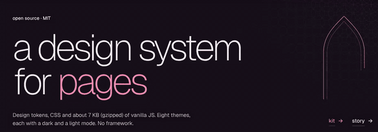
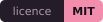
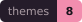
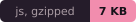
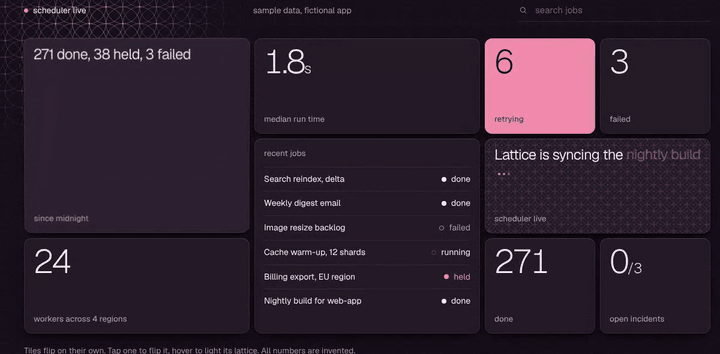
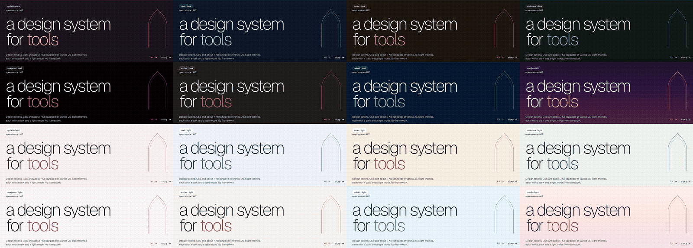
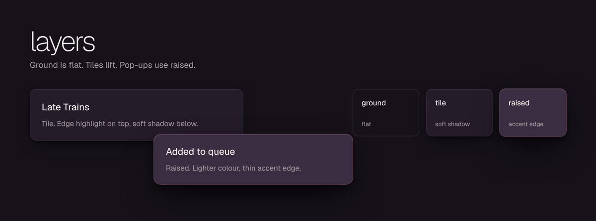
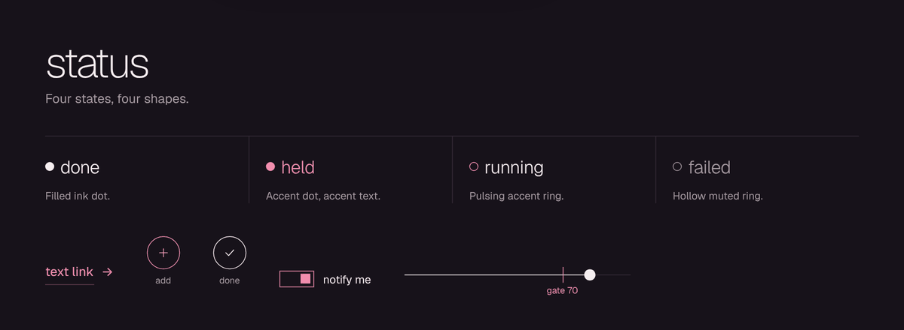

<p align="center">
  
</p>

<h1 align="center">jaali</h1>

<p align="center">
  A small design system for pages, tools and dashboards.<br>
  Thin lowercase titles, hairline structure, live tiles and a lattice background.
</p>

<p align="center">
  
  
  
  
</p>

<p align="center">
  <a href="https://akshatdhabi.github.io/jaali/">Docs</a> ·
  <a href="https://akshatdhabi.github.io/jaali/kit.html">Kit</a> ·
  <a href="https://akshatdhabi.github.io/jaali/examples.html">Examples</a> ·
  <a href="https://akshatdhabi.github.io/jaali/story.html">Story</a>
</p>

Design tokens as JSON and CSS custom properties, CSS components, and about 7 KB (gzipped) of vanilla JS. No framework and no runtime dependencies. MIT.

## Why I built it

I'm from Jaipur, and I like the Zune interface. I wanted my own pages and tools to have its large thin type, sliding pivots and motion, with Jaipur worked in.

Zune is gone. The ideas still work: type as the interface, content over chrome, motion that shows where things come from.

Jaipur is the other half: gulabi (the pink), jaali (the stone lattice), the pointed arch at Amer, blue pottery. Each appears in one small place.

The full story, including the three design rounds and how it was built, is in [docs/story.html](docs/story.html).

## Principles

In priority order. If two conflict, the earlier one wins.

1. **Type.** Thin, lowercase, large. One easing curve for all motion.
2. **Lines.** Hairlines and grids give the structure. Tiles and raised surfaces are the only filled shapes.
3. **Jaipur.** A jaali lattice, an Amer arch, a blue-pottery rosette and one rose accent. Used sparingly, except the lattice.

## What is in it

### Live tiles

Tiles flip on their own, flip again when you tap them, and light the lattice under your cursor.

<p align="center">
  
</p>

### Eight themes, dark and light

Each theme has its own dark and light mode. Switch with `setTheme()` and `setMode()`, or with `data-theme` and `data-mode` on `<html>`.

<p align="center">
  
</p>

### Three layers

<p align="center">
  
</p>

### Status and controls

<p align="center">
  
</p>

## Install

jaali is not on npm. Clone it, build it, and copy the files you need.

```sh
git clone https://github.com/akshatdhabi/jaali
cd jaali
npm install
npm run build
```

The build writes everything to `dist/`. Copy these into your project, for example into a `jaali/` folder:

| file | for |
|---|---|
| `dist/jaali.css` | all styles |
| `dist/fonts.css` and `dist/fonts/` | self-hosted Geist |
| `dist/jaali.js` | JS as an ES module |
| `dist/jaali.iife.js` | JS as a script tag. Exposes a global called `Jaali` |
| `dist/tokens.json` and `dist/tokens.css` | the tokens on their own |

Then link the CSS and add one class:

```html
<link rel="stylesheet" href="jaali/fonts.css">
<link rel="stylesheet" href="jaali/jaali.css">

<body class="jaali">
  <h1 class="j-title">hello</h1>
</body>
```

Everything is opt-in. The base styles only apply under `<body class="jaali">`, and every class is prefixed `j-`, so it will not fight an existing stylesheet.

## Use it

```js
import { mount, jaaliField, themePicker, toggleMode } from './jaali/jaali.js';

mount();                                            // restore theme and mode, slide-ins, cursor glow, flip words, press tilt
jaaliField(document.querySelector('canvas'));       // the lattice behind the page
themePicker(document.querySelector('#themes'));     // one card per theme
document.querySelector('#mode').onclick = toggleMode;
```

Set the theme and mode before first paint to avoid a flash:

```html
<script>
  try {
    var t = localStorage.getItem('jaali:theme'), m = localStorage.getItem('jaali:mode');
    if (t) document.documentElement.dataset.theme = t;
    if (m) document.documentElement.dataset.mode = m;
  } catch (e) {}
</script>
```

### JS API

| function | does |
|---|---|
| `mount(root?)` | Theme restore, reveal on scroll, cursor glow, flip words, press tilt. Returns an undo function. |
| `setTheme(name)`, `getTheme()`, `themes()` | Switch and read the theme. Persists to `localStorage` (`jaali:theme`). |
| `setMode('dark' \| 'light')`, `toggleMode()`, `getMode()` | Dark or light. Follows the system until the visitor picks (`jaali:mode`). |
| `themePicker(list, { toggle, panel })` | Renders a card per theme. Optional dropdown wiring. |
| `jaaliField(canvas)` | The drifting lattice field. Reacts to the cursor. Respects reduced motion. |
| `flipWords(root)` | Turns `<span class="j-flip" data-words="a\|b\|c">` into a flip word. |
| `pivot(el, onPick)`, `turnstile(el, render)` | Pivot strip, and the out-then-in swap of a list. |
| `liveTiles(hub)` | Auto-flips `.j-live[data-j-live]` tiles. Tap to flip. |
| `sheet(el)` | Full-screen detail view with the title carried across. |
| `range(el, onInput)` | Range with a gate marker. |
| `toast(title, text)` | Slides up on the raised layer. |
| `reveal`, `countUp`, `glow`, `tilt`, `scrollSpy` | Smaller pieces used by `mount()`. |
| `motif(kind)`, `rosette()`, `arch()` | Jaipur line figures as SVG strings. |

Types ship in `dist/jaali.d.ts`. The JS never touches the network and never throws if `localStorage` is blocked.

## Tokens

All tokens are `--j-*` custom properties, generated from [`src/tokens/themes.json`](src/tokens/themes.json). Also built to `dist/tokens.json` and `dist/tokens.css`.

Gulabi, the default theme:

| token | dark | light | use |
|---|---|---|---|
| `ground` | `#17121A` | `#F7F2F1` | the page |
| `tile` | `#251C2A` | `#FFFFFF` | content tiles |
| `tileBack` | `#2E2335` | `#F4ECEA` | back face of a flipped tile |
| `raised` | `#3A2D42` | `#FFFFFF` | pop-ins, sheets, menus |
| `line` | `#342A36` | `#E6DAD9` | hairlines |
| `lineSoft` | `#271F2B` | `#F0E7E5` | soft hairlines |
| `ink` | `#F5EEF0` | `#2E1F27` | text |
| `muted` | `#A89AA2` | `#7A6A70` | secondary text |
| `faded` | `#6E6072` | `#A5949B` | tertiary, disabled |
| `accent` | `#F28DAE` | `#B53A61` | the one accent |
| `accentInk` | `#17121A` | `#FBF8F7` | text on accent |

### Themes

Eight, each with dark and light. Gulabi is pinned to the table above. The other seven are derived from a base palette by the rules in `themes.json` (dark tile is the tile mixed 3.5% toward ink, raised is the back face mixed 12% toward ink, and so on).

| theme | feel |
|---|---|
| `gulabi` | home. Warm dark, rose accent |
| `neel` | blue pottery |
| `amer` | sandstone |
| `makrana` | marble and emerald |
| `magenta` | black and magenta |
| `ember` | graphite and orange |
| `cobalt` | midnight and cyan |
| `sanjh` | dusk sky, with a gradient ground |

Select one with `<html data-theme="neel" data-mode="light">`. With no `data-mode`, the system setting decides.

### Layers

Ground, tile and raised.

| layer | token | for |
|---|---|---|
| ground | none, flat | the page and the lattice |
| tile | `--j-shadow-tile` | content |
| raised | `--j-shadow-raised` | toasts, menus, popovers, sheets. Own lighter colour, thin accent edge |

### Status

Status uses shape, not colour: sent is a filled ink dot, held is an accent dot with accent text, running is a pulsing accent ring, failed is a hollow muted ring.

### Motion

One easing, `cubic-bezier(.1, .9, .2, 1)`. 600ms in, 170ms out. Everything honours `prefers-reduced-motion`.

## Fonts

Geist only, variable. `dist/fonts.css` self-hosts it from [`@fontsource-variable/geist`](https://fontsource.org/fonts/geist), so nothing loads from a third party. Geist is licensed under the SIL Open Font License 1.1. The licence text ships in `dist/fonts/OFL.txt`.

## Accessibility

Contrast is audited for every theme and mode (`npm run audit`). Body text, `ink` and `muted` pass everywhere. These pairs fall short today. They are recorded in `src/tokens/known-gaps.json`, and the test suite fails if a new gap appears. I did not change the colours to hide them, because they are palettes picked by eye. Suggested fixes are the nearest passing values.

**Accent and accent-ink (need 4.5:1)**

| pair | ratio | need | colours | nearest passing |
|---|---|---|---|---|
| `amer.light.accent-on-ground` | 4.37 | 4.5 | `#A35F12` on `#f6efe4` | `#9E5C12` |
| `makrana.light.accent-on-ground` | 4.48 | 4.5 | `#0E7F57` on `#f0f3ef` | `#0E7D56` |
| `ember.light.accent-on-ground` | 3.50 | 4.5 | `#D95B00` on `#f4f4f3` | `#B74F05` |
| `ember.light.accent-on-tile` | 3.86 | 4.5 | `#D95B00` on `#FFFFFF` | `#C25303` |
| `ember.light.accentInk-on-accent` | 3.69 | 4.5 | `#FAFAF9` on `#D95B00` | `#191919` |
| `cobalt.light.accent-on-ground` | 4.12 | 4.5 | `#0A7DB0` on `#ebf4fa` | `#0A76A7` |
| `cobalt.light.accentInk-on-accent` | 4.33 | 4.5 | `#F3F9FD` on `#0A7DB0` | none found by the audit |
| `sanjh.light.accent-on-ground` | 4.32 | 4.5 | `#C2492E` on `#fbeee8` | `#BC472E` |

**`faded` text (need 3:1).** 23 pairs, mostly in light mode, including gulabi light (2.59 on ground, 2.87 on tile). `faded` is for disabled and tertiary text, which WCAG exempts when it is disabled, but do not use it for content people must read. `npm run audit` prints every pair with a suggested value.

## Develop

```sh
npm install
npm run build    # tokens, CSS, JS bundles, fonts, docs assets -> dist/ and docs/assets/
npm test         # build, then token, contrast and hygiene tests
npm run audit    # contrast report with suggested fixes
npm run docs     # build and serve the docs on http://localhost:8765
```

Edit tokens in `src/tokens/themes.json`, never in generated CSS. Components live in `src/css/`, behaviour in `src/js/`. See [CONTRIBUTING.md](CONTRIBUTING.md).

## Releasing

Bump `version` in `package.json`, update [CHANGELOG.md](CHANGELOG.md), then push a tag that matches it:

```sh
git tag v0.1.0 && git push --tags
```

jaali is not on npm yet. If you decide to publish, the `publish` workflow runs the tests and publishes when you push a `v*` tag. It needs an `NPM_TOKEN` secret in the repository settings. The `pages` workflow deploys `docs/` to GitHub Pages on every push to `main`.

## Trademark notice

Zune is a trademark of Microsoft. jaali is an independent project. It is not affiliated with, endorsed by, or sponsored by Microsoft, and it uses no Microsoft code, fonts or assets. Zune and Metro are mentioned only to credit the design ideas that inspired it.

## Licence

MIT, see [LICENSE](LICENSE). Geist is under the SIL Open Font License 1.1.
