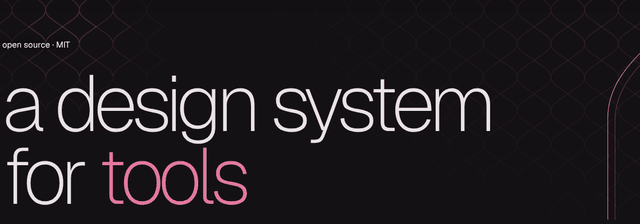
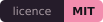
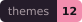
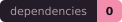
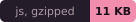
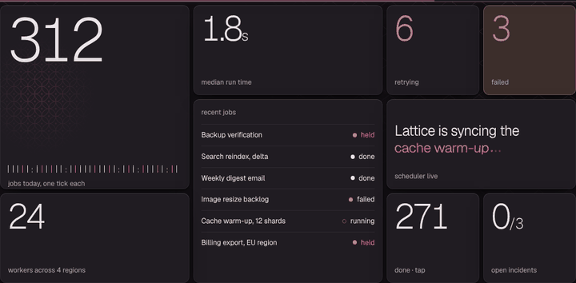
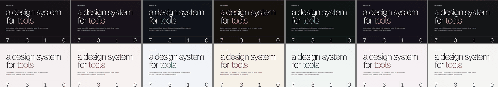
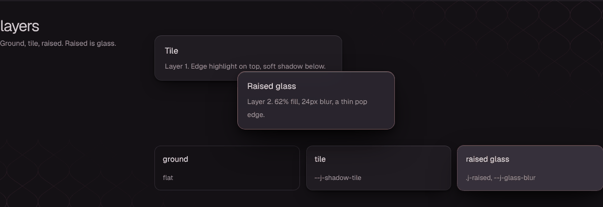
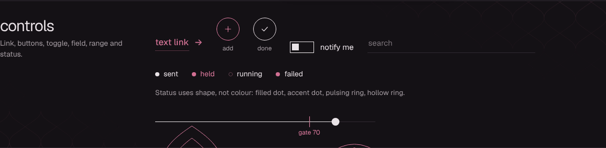

<p align="center">
  
</p>

<h1 align="center">jaali</h1>

<p align="center">
  A small design system for pages, tools and dashboards.<br>
  Thin lowercase titles, hairline structure, flat live tiles and a quiet Rajasthani pattern behind the page.
</p>

<p align="center">
  
  
  
  
</p>

<p align="center">
  <a href="https://akshatdhabi.github.io/jaali/">Docs</a> ·
  <a href="https://akshatdhabi.github.io/jaali/kit.html">Kit</a> ·
  <a href="https://akshatdhabi.github.io/jaali/glass.html">Glass</a> ·
  <a href="https://akshatdhabi.github.io/jaali/flow.html">Flow</a> ·
  <a href="https://akshatdhabi.github.io/jaali/examples.html">Examples</a> ·
  <a href="https://akshatdhabi.github.io/jaali/story.html">Story</a>
</p>

Design tokens as JSON and CSS custom properties, CSS components, and about 11 KB (gzipped) of vanilla JS. No framework and no runtime dependencies. MIT.

## Why I built it

I'm from Jaipur, and I like the Zune interface. I wanted my own pages and tools to have its large thin type, sliding pivots and motion, with Jaipur worked in.

Zune is gone. The ideas still work: type as the interface, content over chrome, motion that shows where things come from.

Jaipur is the other half: gulabi (the pink), jaali (the stone lattice), the pointed arch at Amer, blue pottery, the windows of Hawa Mahal. It lives in a thin pattern behind the page and in one arch and one rosette.

The full story, including the three design rounds and how it was built, is in [docs/story.html](docs/story.html).

## Principles

In priority order. If two conflict, the earlier one wins.

1. **Type.** Thin, lowercase, large. One easing curve for all motion.
2. **Lines.** Hairlines and grids give the structure. Tiles and raised surfaces are the only filled shapes.
3. **Calm.** Tiles are flat. One accent marks things, and a second colour appears only as a tint on the one thing that needs a person. Glass is for what floats. At rest only state indicators and the pattern behind the page move.
4. **Jaipur.** A thin pattern (trellis, Hawa Mahal windows, bandhani dots or lehariya waves), an Amer arch and a blue-pottery rosette. Used sparingly.

## What is in it

### Live tiles

Tiles are flat. They flip when you tap them, and light the lattice under your cursor, with a soft trail. Pass `{ interval }` to `liveTiles()` if you want one to turn itself over now and then.

<p align="center">
  
</p>

### Glass and liquid

The raised layer is glass by default: the top bar, the theme panel, popovers, sheets and toasts blur what sits behind them. Flat tiles carry content. Glass goes only on what floats: bars, pills, menus, sheets and toasts. Liquid motion only answers an action: a tab pill that stretches, a + that grows into its actions, a tile that pours out into a sheet and back, a pager dot that stretches as you scroll, a word that melts into the next. See [docs/glass.html](docs/glass.html).

### Flow

Motion that answers the reader. `velocity()` turns scroll speed into a 0 to 1 value, in JS and as `--j-velocity` in CSS. Call it yourself, since nothing in the base system listens to it any more. `focusGroup()` dims the other items in a group when you point at one, by hover, keyboard or tap, with an opt-in raised tip. See [docs/flow.html](docs/flow.html).

### Seven themes, dark and light

Every theme is calm: lifted ground, soft ink, one accent at moderate saturation and a pop colour used as a tint. `rani` (dusty rose and warm amber) is the default. `gulabi` is the original home palette. `neel`, `amer`, `makrana`, `sanjh` and `calm` come from blue pottery, sandstone, marble, dusk and a neutral ground.

Each theme has its own dark and light mode. Switch with `setTheme()` and `setMode()`, or with `data-theme` and `data-mode` on `<html>`.

<p align="center">
  
</p>

### Calm, the whole system

There is no tier switch. These rules hold everywhere:

- Data tiles are flat. There are no glass tiles, no stage and no lattice field.
- `.is-pop` is a tint of the pop colour: a coloured number, a thin edge, a 15% fill. Use it once a view for what needs a person. Add `.is-slab` for the solid fill.
- `.is-accent` colours a number. It never fills a tile.
- A failed status takes the pop dot, so the row matches the tile.
- At rest only state indicators (running, live, typing) and the pattern move. Card line figures move while you point at the card. The flip word is the one signature motion on a page.

| per view | budget |
|---|---|
| fills | 2: flat tile and raised |
| colours besides ink | 1, plus the pop as a tint, once |
| glass | bar, pills, menus, sheets, toasts |
| ambient motion | the pattern, and one flip word |

`test/style.test.mjs` holds the rules as tests. The pattern comes from `jaaliPattern()` on a `div.j-pattern`. Set `data-pattern` to `ogee`, `win`, `bandhani` or `lehariya` on the element to switch it. It drifts, leans away from the pointer and lights up near it, and draws once under reduced motion.

### Three layers

<p align="center">
  
</p>

### Status and controls

<p align="center">
  
</p>

## Install

jaali is not on npm. Clone it, build it, and copy the files you need.

```sh
git clone https://github.com/akshatdhabi/jaali
cd jaali
npm install
npm run build
```

The build writes everything to `dist/`. Copy these into your project, for example into a `jaali/` folder:

| file | for |
|---|---|
| `dist/jaali.css` | all styles |
| `dist/fonts.css` and `dist/fonts/` | self-hosted Geist |
| `dist/jaali.js` | JS as an ES module |
| `dist/jaali.iife.js` | JS as a script tag. Exposes a global called `Jaali` |
| `dist/tokens.json` and `dist/tokens.css` | the tokens on their own |

Then link the CSS and add one class:

```html
<link rel="stylesheet" href="jaali/fonts.css">
<link rel="stylesheet" href="jaali/jaali.css">

<body class="jaali">
  <div class="j-pattern" data-pattern="ogee" aria-hidden="true"></div>
  <h1 class="j-title">hello</h1>
</body>
```

Everything is opt-in. The base styles only apply under `<body class="jaali">`, and every class is prefixed `j-`, so it will not fight an existing stylesheet.

## Use it

```js
import { mount, themePicker, toggleMode } from './jaali/jaali.js';

mount();                                            // theme and mode, slide-ins, card light, flip words, press tilt, the pattern
themePicker(document.querySelector('#themes'));     // one card per theme
document.querySelector('#mode').onclick = toggleMode;
```

Set the theme and mode before first paint to avoid a flash:

```html
<script>
  try {
    var t = localStorage.getItem('jaali:theme'), m = localStorage.getItem('jaali:mode');
    if (t) document.documentElement.dataset.theme = t;
    if (m) document.documentElement.dataset.mode = m;
  } catch (e) {}
</script>
```

### JS API

| function | does |
|---|---|
| `mount(root?)` | Theme restore, reveal on scroll, cursor glow, flip words, press tilt. Returns an undo function. |
| `setTheme(name)`, `getTheme()`, `themes()` | Switch and read the theme. Persists to `localStorage` (`jaali:theme`). |
| `setMode('dark' \| 'light')`, `toggleMode()`, `getMode()` | Dark or light. Follows the system until the visitor picks (`jaali:mode`). |
| `themePicker(list, { toggle, panel })` | Renders a card per theme. Optional dropdown wiring. |
| `jaaliPattern(canvas, { pattern })` | The backdrop: `ogee`, `win`, `bandhani` or `lehariya`. Drifts, leans away from the pointer, lights up near it. Switch it by setting `data-pattern` on the element. Returns `{ set(pattern), stop() }`. `mount()` starts it for you. |
| `flipWords(root)` | Turns `<span class="j-flip" data-words="a\|b\|c">` into a flip word. |
| `pivot(el, onPick)`, `turnstile(el, render)` | Pivot strip, and the out-then-in swap of a list. |
| `liveTiles(hub, { interval })` | Tap to flip `.j-live[data-j-live]` tiles. Pass `interval` (ms) for occasional automatic flips. |
| `sheet(el)` | Full-screen detail view with the title carried across. |
| `range(el, onInput)` | Range with a gate marker. |
| `toast(title, text)` | Rises out of blur on the raised glass layer. |
| `reveal`, `countUp`, `glow`, `tilt`, `scrollSpy` | Smaller pieces used by `mount()`. |
| `motif(kind)`, `rosette()`, `arch()` | Jaipur line figures as SVG strings. |
| `sheen(root?)` | A highlight follows the mouse on glass. |
| `materialize(el, on)` | Glass rises out of blur (`.j-glass.j-mat`). |
| `stretch(el, onPick)` | Pill tabs whose pill stretches between tabs. |
| `grow(btn)` | A glass + that grows into its row of actions. |
| `pour(tile, render)` | A tile pours out into a glass sheet and back. Esc, × or the veil closes it. |
| `worm(scroller, pager)` | Pager dots tied to horizontal scroll. |
| `melt(el)` | A word that melts into the next (`data-words="a\|b"`). |

Types ship in `dist/jaali.d.ts`. The JS never touches the network and never throws if `localStorage` is blocked.

## Tokens

All tokens are `--j-*` custom properties, generated from [`src/tokens/themes.json`](src/tokens/themes.json). Also built to `dist/tokens.json` and `dist/tokens.css`.

Gulabi, the original theme. Its table is pinned:

| token | dark | light | use |
|---|---|---|---|
| `ground` | `#17121A` | `#F7F2F1` | the page |
| `tile` | `#251C2A` | `#FFFFFF` | content tiles |
| `tileBack` | `#2E2335` | `#F4ECEA` | back face of a flipped tile |
| `raised` | `#3A2D42` | `#FFFFFF` | pop-ins, sheets, menus |
| `line` | `#342A36` | `#E6DAD9` | hairlines |
| `lineSoft` | `#271F2B` | `#F0E7E5` | soft hairlines |
| `ink` | `#F5EEF0` | `#2E1F27` | text |
| `muted` | `#A89AA2` | `#7A6A70` | secondary text |
| `faded` | `#6E6072` | `#A5949B` | tertiary, disabled |
| `accent` | `#F28DAE` | `#B53A61` | the one accent |
| `accentInk` | `#17121A` | `#FBF8F7` | text on accent |

### Themes

Seven, each with dark and light. `rani` is the default. Every theme is pinned: the values in `themes.json` are the values that ship.

| theme | feel |
|---|---|
| `rani` | default. Dusty rose, warm amber pop |
| `gulabi` | warm dark, rose accent. Pinned to the table above |
| `neel` | blue pottery, cornflower, amber pop |
| `amer` | sandstone, gold, terracotta pop |
| `makrana` | marble, sea green, brass pop |
| `sanjh` | dusk, peach, lavender pop |
| `calm` | neutral ground, muted rose, tan pop |

Every theme has `pop` and `popInk` (`--j-pop`, `--j-pop-ink`). Use the pop as a tint, for a held dot, a flag or one tile per view, never for body text.

Select one with `<html data-theme="neel" data-mode="light">`. With no `data-mode`, the system setting decides.

### Layers

Ground, tile and raised. Raised is glass.

| layer | token | for |
|---|---|---|
| ground | none, flat | the page and the lattice |
| tile | `--j-shadow-tile` | content |
| raised (glass) | `.j-raised` or `.j-glass`, `--j-glass-blur` (28px), `--j-glass-fill` (40%), `--j-glass-saturate` (150%), `--j-shadow-raised` | top bar, theme panel, toasts, menus, popovers, sheets. Own lighter colour, thin pop edge. Never on glass, never on reading content |

### Status

Status uses shape, not colour: sent is a filled ink dot, held is an accent dot with accent text, running is a pulsing accent ring, failed is a hollow muted ring.

### Motion

One easing, `cubic-bezier(.1, .9, .2, 1)`. 600ms in, 170ms out. Liquid parts add one spring, `--j-spring` (`cubic-bezier(.3, 1.35, .5, 1)`), for overshoot. Everything honours `prefers-reduced-motion`.

## Fonts

Geist only, variable. `dist/fonts.css` self-hosts it from [`@fontsource-variable/geist`](https://fontsource.org/fonts/geist), so nothing loads from a third party. Geist is licensed under the SIL Open Font License 1.1. The licence text ships in `dist/fonts/OFL.txt`.

## Accessibility

Contrast is audited for every theme and mode (`npm run audit`). Body text, `ink` and `muted` pass everywhere. These pairs fall short today. They are recorded in `src/tokens/known-gaps.json`, and the test suite fails if a new gap appears. I did not change the colours to hide them, because they are palettes picked by eye. Suggested fixes are the nearest passing values.

**`faded` text (need 3:1).** Three pairs, all in gulabi:

| pair | ratio | need | colours | nearest passing |
|---|---|---|---|---|
| `gulabi.dark.faded-on-tile` | 2.80 | 3 | `#6E6072` on `#251C2A` | `#746678` |
| `gulabi.light.faded-on-ground` | 2.59 | 3 | `#A5949B` on `#F7F2F1` | `#99888F` |
| `gulabi.light.faded-on-tile` | 2.87 | 3 | `#A5949B` on `#FFFFFF` | `#A08F96` |

`faded` is for disabled and tertiary text, which WCAG exempts when it is disabled, but do not use it for content people must read. Gulabi stays pinned to its published table. The other six themes pass every check with no gaps, including pop on ground (3:1) and popInk on pop (4.5:1). Text on glass over moving colour is not audited, because glass sits only over the page and its pattern. Glass needs `backdrop-filter` (Chrome 76, Safari 9, Firefox 103) and `color-mix` (Chrome 111, Safari 16.2, Firefox 113). Without `backdrop-filter`, glass falls back to the solid raised colour.

## Develop

```sh
npm install
npm run build    # tokens, CSS, JS bundles, fonts, docs assets -> dist/ and docs/assets/
npm test         # build, then token, contrast and hygiene tests
npm run audit    # contrast report with suggested fixes
npm run docs     # build and serve the docs on http://localhost:8765
```

Edit tokens in `src/tokens/themes.json`, never in generated CSS. Components live in `src/css/`, behaviour in `src/js/`. See [CONTRIBUTING.md](CONTRIBUTING.md).

## Releasing

Bump `version` in `package.json`, update [CHANGELOG.md](CHANGELOG.md), then push a tag that matches it:

```sh
git tag v0.1.0 && git push --tags
```

jaali is not on npm yet. If you decide to publish, the `publish` workflow runs the tests and publishes when you push a `v*` tag. It needs an `NPM_TOKEN` secret in the repository settings. The `pages` workflow deploys `docs/` to GitHub Pages on every push to `main`.

## Trademark notice

Zune is a trademark of Microsoft. jaali is an independent project. It is not affiliated with, endorsed by, or sponsored by Microsoft, and it uses no Microsoft code, fonts or assets. Zune and Metro are mentioned only to credit the design ideas that inspired it.

## Licence

MIT, see [LICENSE](LICENSE). Geist is under the SIL Open Font License 1.1.
